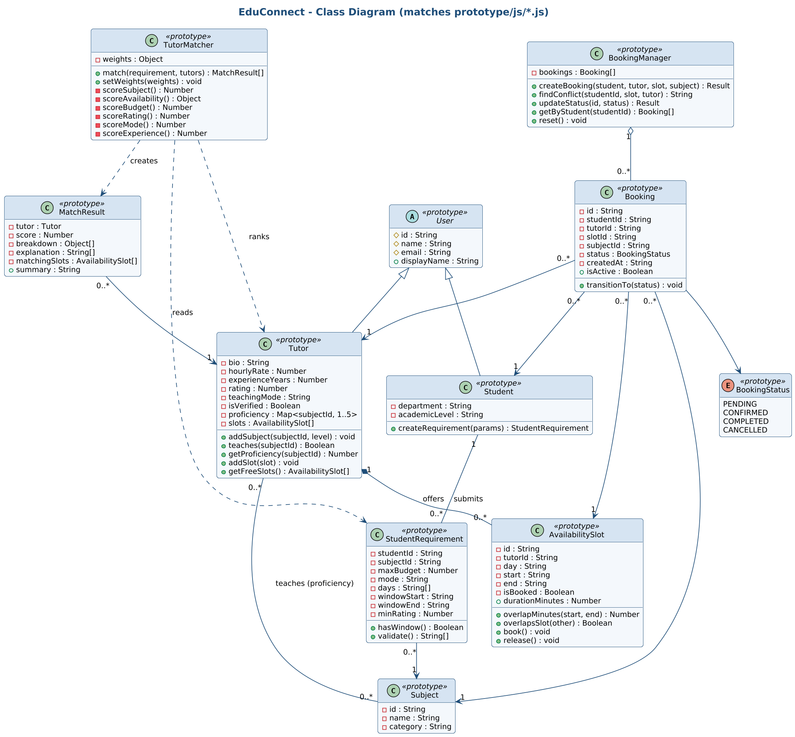

# EduConnect - Smart Student-Tutor Matching System

**Final Capstone Project Proposal and Prototyping - Part I**
Mawlana Bhashani Science and Technology University (MBSTU), Bangladesh

| | |
|---|---|
| Student | `[Sanjith Saha]` |
| Student ID | `[IT-24044]` |
| Course | `[Software Engineering and Project Management ]` (`[ICT-3107]`) |
| Instructor | `Dr. Ziaur Rahman]` |

EduConnect helps a student find the best tutor: it ranks tutors with a **transparent weighted score**, explains every score, checks **real availability**, and lets the student request a slot while **preventing double bookings**.

## Deliverables at a glance

| Requirement | Where |
|---|---|
| Professional LaTeX proposal (Overleaf-ready) + bibliography | [`docs/proposal/main.tex`](docs/proposal/main.tex), [`references.bib`](docs/proposal/references.bib), compiled [`EduConnect_Proposal.pdf`](docs/proposal/EduConnect_Proposal.pdf) |
| 8-week schedule, dependencies, milestones, Gantt chart | [`docs/schedule/schedule.md`](docs/schedule/schedule.md), [`tasks.csv`](docs/schedule/tasks.csv) |
| Six diagrams with editable sources | [`diagrams/`](diagrams) (see table below) |
| Working prototype (HTML/CSS/vanilla JS, 10 classes + 1 enum) | [`prototype/`](prototype) |
| Database design | [`database/schema.sql`](database/schema.sql) |
| Testing checklist + automated tests | [`docs/TESTING_CHECKLIST.md`](docs/TESTING_CHECKLIST.md), [`tests/`](tests) |

## Quick start

```bash
git clone <your-repo-url> && cd EduConnect

# 1. Run the prototype (no build step, no server needed)
open prototype/index.html            # or double-click it; optional: cd prototype && python3 -m http.server 8000

# 2. Run the tests
node tests/run-tests.js              # 19 logic tests (Node 18+, no dependencies)
python3 tests/test_schema.py         # 5 schema checks (SQLite)
python3 tests/check_consistency.py   # class diagram <-> code, ERD <-> SQL, figures, citations
```

**Try it:** open the prototype, click **Load demo scenario**, read the ranked list and the *Why this score?* table, then click a green slot to request a booking. Switch the student to *Tanvir Hossain* and try the same slot (conflict), or use **Tutor accepts** / **Cancel** to move the booking through its statuses.

### Compile the proposal
- **Overleaf:** *New Project -> Upload Project* with a ZIP of the `docs/proposal/` folder; compiler pdfLaTeX; main file `main.tex`. It is self-contained (figures and generated tables are inside the folder).
- **Locally:** `cd docs/proposal && pdflatex main && bibtex main && pdflatex main && pdflatex main` (needs `pgfgantt`, included in TeX Live/MiKTeX).

### Rebuild diagrams and the Gantt chart (optional)
Needs Java, Graphviz and `plantuml.jar` (download from the [PlantUML releases](https://github.com/plantuml/plantuml/releases) into `tools/`), plus Python with `matplotlib`.
```bash
python3 docs/schedule/gantt.py     # Gantt PNG/SVG + LaTeX tables from tasks.csv
./tools/render_diagrams.sh         # all diagrams -> diagrams/png, diagrams/svg, docs/proposal/figures
./tools/build_all.sh               # everything + all tests (+ PDF if pdflatex is installed)
```
Diagram sources can also be pasted into the [PlantUML web server](https://www.plantuml.com/plantuml) (`.puml`) or any Graphviz viewer (`.dot`).

## Repository structure

```
EduConnect/
|-- README.md
|-- LICENSE
|-- database/schema.sql              # relational schema (matches the ERD)
|-- diagrams/
|   |-- source/                      # editable: *.puml (PlantUML), *.dot (Graphviz)
|   |-- png/  svg/                   # rendered diagrams
|-- docs/
|   |-- proposal/                    # main.tex, references.bib, figures/, generated/, EduConnect_Proposal.pdf
|   |-- schedule/                    # tasks.csv (source), gantt.py, gantt.png/svg, schedule.md
|   |-- TESTING_CHECKLIST.md
|-- prototype/
|   |-- index.html, css/styles.css
|   |-- js/ models.js  data.js  matcher.js  bookingManager.js  app.js
|-- tests/                           # run-tests.js, test_schema.py, check_consistency.py
|-- tools/                           # render_diagrams.sh, build_all.sh
```

## Diagrams

| # | Diagram | Editable source | Image |
|---|---|---|---|
| 1 | Data Flow Diagram (Level 1; Level 0 context also provided) | [`dfd_level1.dot`](diagrams/source/dfd_level1.dot), [`dfd_level0.dot`](diagrams/source/dfd_level0.dot) | [PNG](diagrams/png/dfd_level1.png) |
| 2 | Use Case Diagram | [`usecase.puml`](diagrams/source/usecase.puml) | [PNG](diagrams/png/usecase.png) |
| 3 | Activity Diagram | [`activity.puml`](diagrams/source/activity.puml) | [PNG](diagrams/png/activity.png) |
| 4 | Entity Relationship Diagram | [`erd.puml`](diagrams/source/erd.puml) | [PNG](diagrams/png/erd.png) |
| 5 | Class Diagram | [`class.puml`](diagrams/source/class.puml) | [PNG](diagrams/png/class.png) |
| 6 | Object Diagram | [`object.puml`](diagrams/source/object.puml) | [PNG](diagrams/png/object.png) |
| + | System architecture (supplementary) | [`architecture.puml`](diagrams/source/architecture.puml) | [PNG](diagrams/png/architecture.png) |



## Prototype

**Classes (all appear in the class diagram):** `User`, `Student`, `Tutor`, `Subject`, `AvailabilitySlot`, `StudentRequirement`, `MatchResult`, `TutorMatcher`, `Booking`, `BookingManager`, plus the `BookingStatus` enum - implemented in `prototype/js/` (10 classes + 1 enum).

**Matching score** = 100 x sum(weight x component) / sum(weights). Default weights: subject expertise 30, availability 25, budget 15, rating 15, teaching mode 10, experience 5 (adjustable in the UI). A tutor must teach the subject; every other factor is a soft score with a visible explanation.

**Conflict prevention:** a booking is rejected if the slot is already booked, the tutor has an overlapping active booking, or the student has an overlapping active booking. Statuses: Pending -> Confirmed -> Completed, or Cancelled (releases the slot).

### Prototype limitations
- Front-end only: no server, login or real database; bookings are kept in `localStorage`.
- Sample tutors, ratings and prices are **fictional**.
- Availability is a recurring weekly slot (no dates, time zones or recurrence rules).
- Tutor responses (accept/decline/complete) are **simulated** with buttons.
- Weights are hand-chosen defaults, not learned; client-side conflict checks must be repeated server-side (the SQL schema already contains the guard index).
- No payments, reviews, notifications, admin screens or accessibility audit beyond basic labels and keyboard use.

## Consistency map

| Concept | Report | Diagram | Database | Code |
|---|---|---|---|---|
| Tutor skills with proficiency | Sec. 9.5 | ERD `tutor_subjects`, Class `Tutor.proficiency` | `tutor_subjects` | `Tutor.addSubject()` |
| Availability | Sec. 9.8 | DFD `D3`, Class `AvailabilitySlot` | `availability_slots` | `AvailabilitySlot` |
| Student requirement | FR3 | UC3, Class `StudentRequirement` | `match_requests` | `StudentRequirement` |
| Booking and status | FR7-FR10 | Activity, Class `Booking` | `bookings` + partial unique index | `BookingManager` |

`python3 tests/check_consistency.py` verifies the class list, ERD/SQL tables, figures and citation keys automatically.

## Before you submit
1. Replace every placeholder: `grep -rn "\[Student\|\[Course\|\[Instructor\|\[Submission\|\[Department\|\[access date\|\[amount\|\[Start Date" .`
2. Open the proposal in Overleaf and confirm it compiles; check the PDF page by page.
3. **Verify every reference** (title, year, URL, access date) against the original source and add your own sources where your instructor requires them.
4. Run the manual [testing checklist](docs/TESTING_CHECKLIST.md) and record the results.
5. Read and understand every file; follow your university's policy on tool-assisted work and cite any assistance as required.
6. Add your repository URL and, optionally, publish `prototype/` with GitHub Pages.

## License
MIT (see [LICENSE](LICENSE)); replace the copyright holder with your name.
