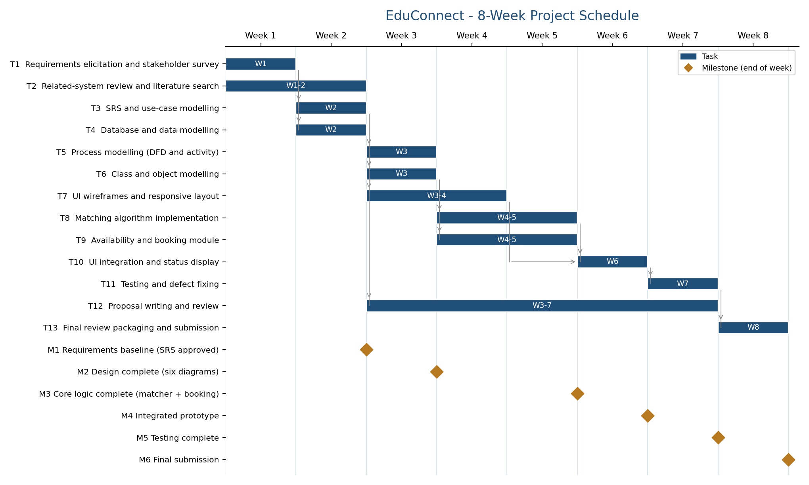

# EduConnect - 8-Week Schedule

Single source of truth: [`tasks.csv`](tasks.csv). Regenerate everything with `python3 docs/schedule/gantt.py`
(outputs `gantt.png`, `gantt.svg`, LaTeX fragments for the proposal, and `schedule_tables.md`).
Week 1 starts on `[Start Date]`; every task starts in a later week than all of its predecessors end (finish-to-start).

| ID | Task | Weeks | Depends on | Deliverable |
|---|---|---|---|---|
| T1 | Requirements elicitation and stakeholder survey | 1 | - | Requirement notes; survey summary |
| T2 | Related-system review and literature search | 1-2 | - | Literature summary; reference list |
| T3 | SRS and use-case modelling | 2 | T1 | SRS draft; Use Case Diagram |
| T4 | Database and data modelling | 2 | T1 | ERD; relational schema |
| T5 | Process modelling (DFD and activity) | 3 | T3 | DFD (L0/L1); Activity Diagram |
| T6 | Class and object modelling | 3 | T3,T4 | Class Diagram; Object Diagram |
| T7 | UI wireframes and responsive layout | 3-4 | T3 | Wireframes; CSS foundation |
| T8 | Matching algorithm implementation | 4-5 | T6 | matcher.js; unit tests |
| T9 | Availability and booking module | 4-5 | T6 | bookingManager.js; conflict tests |
| T10 | UI integration and status display | 6 | T7,T8,T9 | Integrated prototype |
| T11 | Testing and defect fixing | 7 | T10 | Test results; testing checklist |
| T12 | Proposal writing and review | 3-7 | T3 | main.tex; proposal PDF |
| T13 | Final review packaging and submission | 8 | T11,T12 | GitHub repository; ZIP |

| Milestone | End of week | Gate task(s) | Exit criterion |
|---|---|---|---|
| M1 Requirements baseline (SRS approved) | 2 | T3,T4 | SRS signed off |
| M2 Design complete (six diagrams) | 3 | T5,T6 | All six diagrams reviewed |
| M3 Core logic complete (matcher + booking) | 5 | T8,T9 | Unit tests pass |
| M4 Integrated prototype | 6 | T10 | Demo scenario runs end to end |
| M5 Testing complete | 7 | T11 | Checklist signed off |
| M6 Final submission | 8 | T13 | Submitted package |

## Process model
Incremental development with evolutionary prototyping in one-week sprints (justification in the proposal, Section 7).
